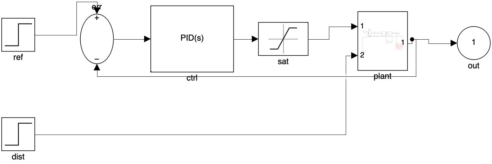
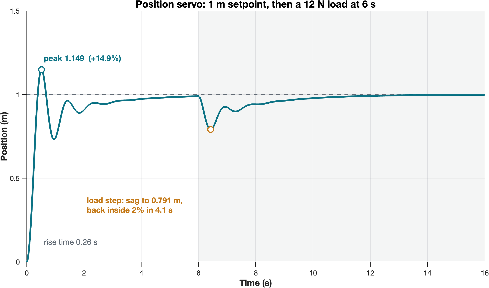
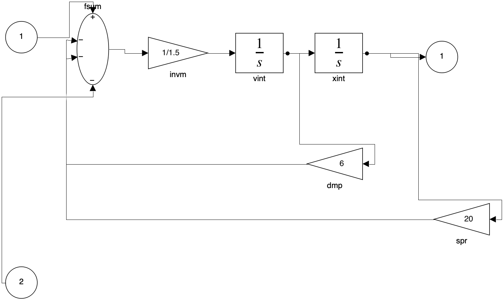
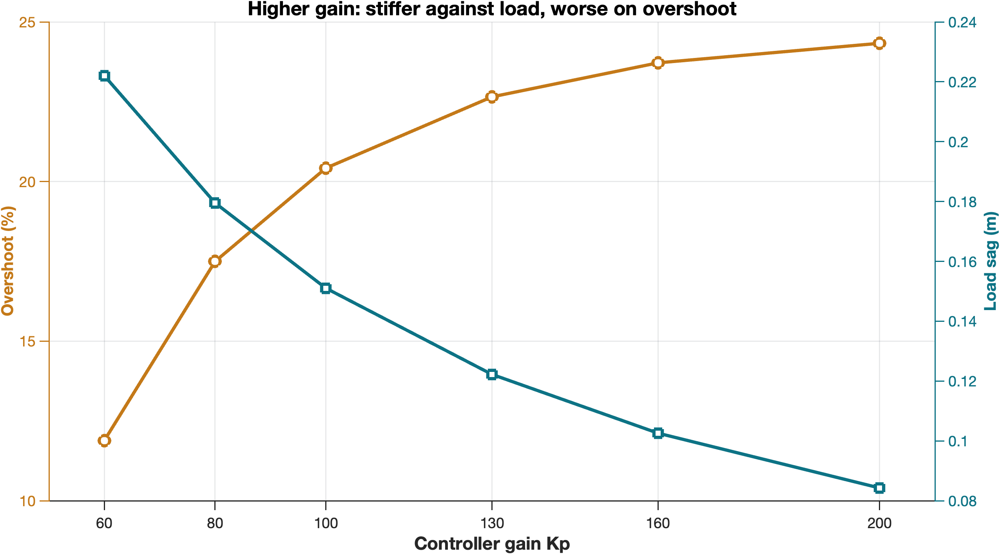

# dsh-simulink-mcp

[](https://www.npmjs.com/package/dsh-simulink-mcp)[](LICENSE)[]()

DSH plugin that gives the agent — and the settings UI — control of a live
Simulink session. It registers the MathWorks MCP server plus 32 Simulink tools
(`mcp__simulink__sl_*`), ships its own runtime, installs four agent skills, and
adds a **Simulink** settings page.

## Install

```sh
dsh plugin --profile desktop add dsh-simulink-mcp
```

or install it from the DSH plugin market. Either way, reload the window after
installing so the settings page appears.

| | |
| --- | --- |
|  |  |
| **Build** — one JSON spec, wired and grouped | **Measure** — overshoot, rise, settling, steady state |
|  |  |
| **Inspect** — inside a subsystem, not just the top level | **Sweep** — gain against load rejection, one chart |

## What it installs

| Piece | Where | Purpose |
| --- | --- | --- |
| MCP server row (`id: mcp-simulink`) | composition | stdio row that attaches to MATLAB |
| Runtime copy | `$DSH_HOME/simulink-mcp/runtime/` | `bin/matlab-mcp-server`, `matlab/sl_*.m`, `tools/simulink-tools.json` |
| Skills | `$DSH_HOME/skills/simulink-{modeling,simulation,debugging,testing}/` | build / simulate / debug / verify guidance |
| `startup.m` line | `~/Documents/MATLAB/startup.m` | `shareMATLABSession` + `addpath` to the mirrored runtime |
| Settings page | DSH 设置 → **Simulink 建模** | connection status, loaded models, diagram preview |

The package is self-contained: the only machine-specific value in
`cordis.patch.yml` is the `$DSH_HOME` prefix. Copy the folder to another Mac and
it resolves its own paths after install.

## Prerequisites

1. MATLAB R2022b or newer with Simulink, anywhere on disk. On macOS the
   launcher scans `/Applications/MATLAB_R*.app`; on Windows it checks
   `MATLAB_ROOT`, the MathWorks registry keys, `Program Files\MATLAB`, and
   every drive (portable installs like `F:\matlab`). What it searched is
   written to `runtime/.matlab-search.json`.
2. A running MATLAB desktop session. `apply()` rewrites the `addpath` line in
   `~/Documents/MATLAB/startup.m` on install, so every new session is shared and
   has the tool functions on its path.

If MATLAB is closed, DSH still starts (`failOnStartupError: false`); the tools
and the panel report the failure instead of blocking the app.

## What the agent can do

| Stage | Tools |
| --- | --- |
| Session | `sl_env`, `sl_set_folder`, `sl_last_error`, `sl_selftest` |
| Build | `sl_new`, `sl_open`, `sl_save`, `sl_close`, `sl_add_block`, `sl_add_line`, `sl_delete`, `sl_delete_line`, `sl_set_param`, `sl_cleanup`, `sl_layout` |
| Read | `sl_list_models`, `sl_blocks`, `sl_ports`, `sl_lines`, `sl_trace`, `sl_block_params`, `sl_lib_search` |
| Look | `sl_show`, `sl_snapshot`, `sl_highlight`, `sl_plot` |
| Verify | `sl_update`, `sl_sim`, `sl_sim_data`, `sl_metrics` |

Two tools exist purely because guessing went wrong in practice: `sl_trace`
follows one signal path instead of dumping every line, and `sl_metrics` returns
overshoot / rise time / settling time / steady-state error instead of leaving
the agent to read a plot by eye.

### 设置面板

设置 → 插件 → Simulink 建模，有三块内容：连接状态（版本、pid、工具箱数、工作目录、
运行时同步结果）、模型列表（点开某个模型会显示结构图快照）、最近一次 MATLAB 错误。

- **打开面板不会启动 MATLAB**：普通读取只回缓存；只有当 MATLAB 进程已经在跑（附加是安全的）
  或你点了「刷新」（`?probe=1`）才会做实时探测。
- 「自动打开 MATLAB」开关写到 `$DSH_HOME/simulink-mcp/settings.json`，DSH 启动 5 秒后在后台
  拉起会话；开启/关闭都会立即返回，启动过程由面板轮询显示（已开启 / 正在启动 / 启动失败）。
  关闭只停止"以后自动启动"，不会杀掉正在跑的 MATLAB。

`sl_selftest` builds a throwaway model in the MATLAB temp folder, wires it,
compiles, simulates, reads data, snapshots, saves, checks error reporting and
cleans up — use it to prove an install works.

## HTTP surface

The host plugin serves four routes under `/plugin-simulink` (dispatch matches
the path suffix, so it works whether or not the host strips the prefix):

- `GET /status` — `{sync, env, models, error}` from `sl_env`, `sl_list_models`
  and `sl_last_error`
- `GET /snapshot?model=<name>` — the model diagram as `image/png`
- `GET /debug?tool=<mcp tool name>&args=<json>` — the raw settled tool batch,
  for diagnosing a tool-payload change without guessing
- `POST /act` — `{action: "show" | "open" | "env", model?, path?}`

## Troubleshooting

- **Panel shows nothing after install** — the client half loads with the page.
  Reload the window (⌘R).
- **Tools report `model file not found` for a real file** — check which
  `sl_*.m` MATLAB resolves: `which sl_open` must point at
  `$DSH_HOME/simulink-mcp/runtime/matlab/`. An older copy earlier on the path
  wins otherwise; `rmpath` it and `addpath` the runtime folder.
- **Host-side JS change does not take effect** — disabling and re-enabling the
  bundle row re-imports the module; a full app restart is not required.

## 平台与安装

包里带两个平台的服务器二进制（`runtime/bin/darwin-arm64`、`runtime/bin/win32-x64`）。
`runtime/launcher.cjs` 按当前平台选二进制、找 MATLAB、补参数，所以
`cordis.patch.yml` 里没有绝对路径，同一份包在 macOS 和 Windows 上都能装。

- Windows 步骤与验证清单见 [INSTALL-WINDOWS.md](INSTALL-WINDOWS.md)。
- MATLAB 不在默认目录时，启动器会扫注册表、`Program Files\MATLAB` 和所有盘符（覆盖
  `F:\matlab` 这类便携安装）；扫过的路径记录在 `runtime/.matlab-search.json`。要显式指定，
  设 `MATLAB_ROOT`（不要带 `\bin`）。
- 输出一律走 `SaveFormat='Array'`：`Dataset` 需要 Simulink signal observer，而 Windows 的
  应用控制策略可能把那个 DLL 拦掉（见 `INSTALL-WINDOWS.md` 第 6 节）。

## 示例模型

`examples/mkt_servo.slx` 是本仓库所有截图用的模型：位置伺服，`ref`(1 m 阶跃) →
`err` → `PID`(Kp 60 / Ki 40) → `sat`(±40 N) → `plant`(子系统) → `out`，`dist` 在 6 s
加 12 N 负载。`plant` 内部是 `1/m`、速度/位置两个积分器和弹簧/阻尼反馈。

装好后可以让 agent 直接跑：

```
打开 examples/mkt_servo.slx，列出顶层块，编译并从 0 仿真到 16 秒，把 out 的位置曲线画出来
```

## 许可证

本仓库的插件代码（Host/Client 插件、`runtime/matlab/sl_*.m`、技能、文档）是 MIT。

`runtime/bin/` 下的 `matlab-mcp-server` 二进制来自 MathWorks 的
[matlab-mcp-server](https://github.com/matlab/matlab-mcp-server)，按其自身许可分发，
**只可与 MathWorks 产品一起使用**——它不含 MATLAB，也不代替 MATLAB 授权。

`runtime/launcher.cjs` 只做一件事：挑平台二进制、找 MATLAB、把参数接起来。
